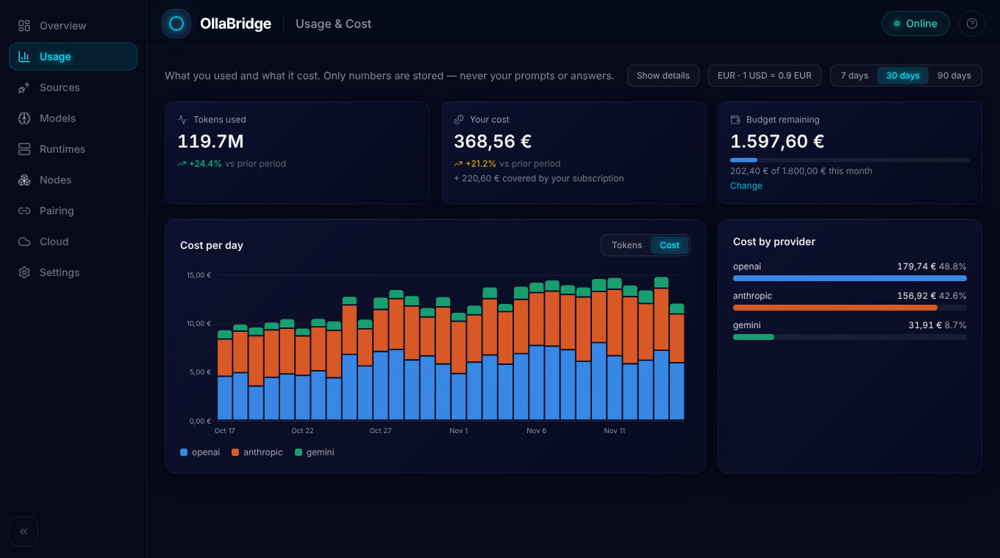
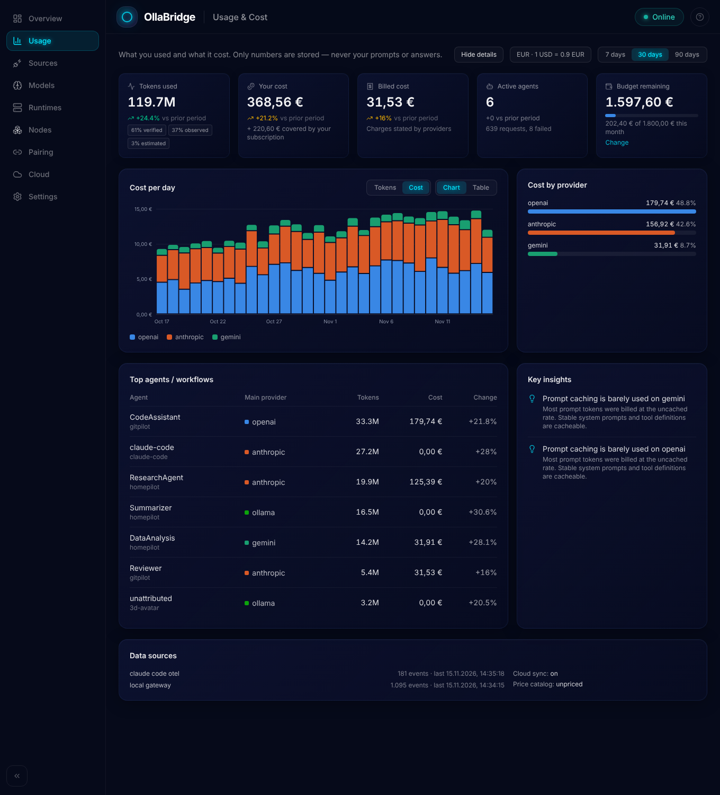

# Usage & Cost — user guide

The **Usage** page shows what you used and what it cost. It works on its own,
with no cloud account. Only numbers are stored — never your prompts or answers.



*Screens in this guide use sample data.*

## What you see

| On the page | What it means |
| --- | --- |
| **Tokens used** | How much text went through the gateway. The arrow compares with the previous period of the same length. |
| **Your cost** | What that usage cost on pay-per-use providers. |
| **Budget remaining** | What is left of the monthly budget you set. |
| **Cost per day / Tokens per day** | One bar per day, coloured by provider. Switch with **Tokens / Cost**. Hover a bar for that day's figures. |
| **Cost by provider** | Each provider's share for the period. |

Top right: choose **7, 30 or 90 days**.

Two lines can appear under **Your cost**:

- **"+ … covered by your subscription"** — usage on a subscription, such as
  Claude Code on a plan. It is shown at pay-per-use prices so you can compare,
  but you are not charged per use.
- **"Some models have no price set, so this is a minimum"** — a model you used
  has no price in the price list yet, so the real cost is higher than shown.

## Common tasks

### Set a monthly budget

Click **Set budget** (or **Change**) on the budget card, type the amount and
save. Enter `0` to remove it. The budget is a guide: nothing is blocked when
you go over it.

### Show costs in euros

Click the currency button (top right), choose **EUR**, type how many euros one
US dollar buys, and save. Or from a terminal, replacing `<rate>`:

```bash
ollabridge usage currency EUR --rate <rate>
```

Providers charge in US dollars, so amounts are converted for display at the
rate you enter. Update it when the rate moves; totals are close to, not
exactly, what your bank charged.

### Include Claude Code

Run this and add the lines it prints to your shell profile, then restart
Claude Code:

```bash
ollabridge usage claude-code
```

Claude Code is counted as subscription usage. If you run it with an API key
instead, set `CLAUDE_CODE_BILLING=api` so it counts as cost.

### See it in the terminal

```bash
ollabridge usage summary
```

### See all your devices together

Pair this device with OllaBridge Cloud, then turn on usage upload (it is off
by default):

```bash
ollabridge sync config usage_metadata true
```

Only the numbers are uploaded. Your prompts, answers and provider keys stay on
this device.

## More detail

Click **Show details** for the full view: charges stated by providers, the
number of active agents, how each figure was measured, the top agents, insights
and where the data came from. Your choice is remembered.



| Detail | What it means |
| --- | --- |
| **verified / observed / estimated** | How a token count was obtained: reported by the provider, counted on this device, or approximated from the length of the text. |
| **Billed cost** | Charges a provider stated itself. |
| **Top agents / workflows** | Which app and agent used what. Apps can label their requests with the `X-OllaBridge-App` and `X-OllaBridge-Agent` headers; otherwise they appear as "unattributed". |
| **Key insights** | Things worth a look, each based on the numbers on this page. Nothing is changed automatically. |
| **Data sources** | Where the numbers came from and when each source last reported. |

## Good to know

- **No cost showing?** Costs appear when a provider states its charge, when
  Claude Code reports its estimate, or when the model has a price in your
  price list (`USAGE_PRICING_FILE`). The built-in price list is empty.
- **Estimated counts.** Streamed answers, and requests served by another
  machine, are counted from the length of the text and marked "estimated".
- **Turn recording off** with `USAGE_ENABLED=false`.
- **Delete old records** with `ollabridge usage prune --keep-days 90`.

For how it is built, see [USAGE_INTELLIGENCE.md](USAGE_INTELLIGENCE.md).
