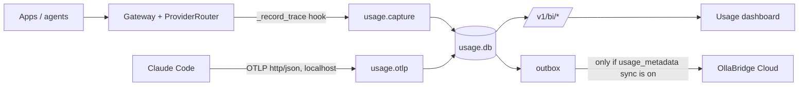

# Usage Intelligence — Local Architecture RFC

**Status:** proposal · **Scope:** OllaBridge Local · **Date:** 2026-11-15

Goal: let OllaBridge Local measure token consumption and cost for everything
it serves, receive Claude Code telemetry, show a local usage dashboard that
works with no cloud account, and optionally sync usage **metadata** to
OllaBridge Cloud for a cross-device view.

The design is additive. Nothing existing is removed or reshaped; with the new
settings off, behaviour is unchanged.

---

## 1. Starting point (from the current code)

| Area | File | Today |
| --- | --- | --- |
| Request traces | `tracing/store.py` | SQLite `traces.db`, metadata only, pruned to the newest 10 000 rows — fine for debugging, too short-lived for accounting |
| Token counts | `api/main.py` (`_estimate_tokens`) | Traces store **estimated** tokens; the provider's real `usage` block is not kept |
| Cost | `tracing/store.py`, `policies/engine.py` | `estimated_cost_usd` is `0.0` for local and empty otherwise; `_COST_PER_1K` is one hard-coded blended price per provider, used by `route explain` |
| Quotas | `addons/providers/quotas.py`, `registry.py` | In-memory monthly counters, reset on restart |
| Single choke point | `api/main.py` → `_record_trace` | Every served request passes through it |
| Consent | `cloud/sync_config.py` | Metadata vs sensitive categories; nothing syncs unless enabled |
| UI | `frontend/` | React 19, Tailwind 4, react-query; no chart library |

---

## 2. What gets added

```
src/ollabridge/usage/
  contract.py      # shared event schema (ollabridge-usage/1)
  normalize.py     # provider usage → disjoint token dimensions
  store.py         # ~/.ollabridge/usage.db (SQLite, WAL)
  capture.py       # record_attempt(...) — called from the trace hook
  pricing.py       # versioned price catalog + cost computation
  otlp.py          # OTLP http/json receiver for Claude Code
  outbox.py        # consented batch upload to OllaBridge Cloud
  budgets.py       # persistent local budgets
  routes.py        # /v1/bi/* read API + /otlp/v1/*
  catalog/pricing.seed.yaml
src/ollabridge/cli/usage.py     # `ollabridge usage ...`
frontend/src/pages/intelligence/   # dashboard pages
```



### 2.1 Why a separate `usage.db`

`traces.db` is left exactly as it is: same schema, same pruning, same CLI.
Accounting needs different guarantees — long retention, idempotency keys,
integer money, sync state — so it gets its own file with WAL enabled and the
same `paths.tighten_permissions` treatment. A usage event links back to its
trace through `trace_id = request_id`.

Tables: `usage_events` (canonical events + `sync_state`), `price_catalog`,
`adjustments` (subscriptions, hardware/energy, provider statements),
`budgets`, `connections` (source health and last-seen time).

---

## 3. The shared event contract (`ollabridge-usage/1`)

One record per real inference attempt.

```json
{
  "schema_version": 1,
  "event_id": "att_01JCX...",
  "trace_id": "req_...",
  "task_id": null,
  "occurred_at": "2026-11-15T13:00:00.000Z",
  "source": "local_gateway",
  "device_id": "dev_...",
  "application_id": "homepilot",
  "agent_id": "coding-agent",
  "account_ref": "acct_openrouter_personal",
  "provider": "anthropic",
  "billing_provider": "openrouter",
  "model": "…",
  "requested_model": "coding",
  "execution": "provider_api",
  "billing_mode": "api",
  "usage": {
    "input_tokens": 1200,
    "cache_read_tokens": 9000,
    "cache_write_tokens": 0,
    "output_tokens": 350,
    "reasoning_tokens": null,
    "other_units": {}
  },
  "measurement": "provider_reported",
  "cost": { "currency": "USD", "estimated_micro": null,
            "provider_reported_micro": 4123, "pricing_version": null },
  "status": "completed",
  "error_category": null,
  "streamed": true,
  "latency_ms": 1840
}
```

Rules:

- `event_id` is the idempotency key. Retries and failover attempts get their
  own id and share a `trace_id`.
- Token dimensions are **disjoint**; totals are derived. Providers differ on
  whether cached and reasoning tokens are included in headline counts, so all
  normalisation lives in `normalize.py` and is pinned by fixtures per
  provider.
- Unknown values are `null`, never `0`.
- Money is integer micro-USD.
- The schema rejects unknown fields and has no field for prompt or response
  text.
- `billing_provider` is who charges for the call (e.g. OpenRouter), which may
  differ from `provider` (the model's vendor).
- `billing_mode`: `api | subscription | local | free_tier`. Subscription
  usage is never presented as an API bill.

Measurement classes, shown as badges in the UI:

| Class | Meaning |
| --- | --- |
| `provider_billed` | from a provider billing/usage API |
| `provider_reported` | `usage` block of the inference response |
| `locally_observed` | counted by a local runtime or by Claude Code telemetry |
| `estimated` | heuristic tokenisation |
| `unavailable` | the provider/account does not expose it |

Optional attribution headers accepted by the gateway: `X-OllaBridge-App`,
`X-OllaBridge-Agent`, `X-OllaBridge-Task`, `X-OllaBridge-Trace`,
`X-OllaBridge-Attempt-Id`. When absent, `application_id` falls back to the
existing `x-client-type`.

The contract file and its fixtures are mirrored in OllaBridge Cloud; a
conformance test in `tests/conformance/` keeps the two copies identical.

---

## 4. Capture

### 4.1 Edits to existing files (small and guarded)

| File | Change |
| --- | --- |
| `api/main.py` `_record_trace` | after the existing trace write, one best-effort call to `usage.capture.record_attempt(request, **fields)`. Same `try/except` discipline: usage capture can never affect serving. |
| `api/main.py` chat / embeddings handlers | pass the provider's real usage through as a new optional field `usage_raw` when the backend returned one; the existing estimated fields stay. |
| `addons/providers/adapters/*.py` | additionally return the untouched provider usage under a new `usage_raw` key. Existing `usage` keys are unchanged. |
| `addons/providers/router.py` | emit an event for each failed candidate, so failover is visible. |
| `cloud/sync_config.py` | one new metadata category `usage_metadata`, **default `False`**. |
| `cli/main.py`, `api/main.py` | register the new CLI group and router. |
| `frontend/src/layouts/SidebarNav.tsx`, `App.tsx` | one new nav item, "Usage". |

How measurement is chosen: `usage_raw` present → `provider_reported`; Ollama
runtime counts → `locally_observed`; only `_estimate_tokens` available →
`estimated`; stream cut off with nothing → `unavailable` (the estimate is
kept alongside, clearly labelled).

For streaming through OpenAI-compatible upstreams, usage only arrives if the
request asks for it in the final chunk; the OpenAI-compatible adapter should
request it when the capture setting is on.

### 4.2 Claude Code telemetry

Claude Code can export OpenTelemetry data. OllaBridge Local exposes an OTLP
**http/json** receiver on the existing server (default port 11435), so no
protobuf or collector dependency is needed:

```bash
export CLAUDE_CODE_ENABLE_TELEMETRY=1
export OTEL_LOGS_EXPORTER=otlp
export OTEL_METRICS_EXPORTER=otlp
export OTEL_EXPORTER_OTLP_PROTOCOL=http/json
export OTEL_EXPORTER_OTLP_ENDPOINT=http://127.0.0.1:11435/otlp
```

- Per-request log events are the primary source (one usage event per API
  request, with input, output, cache-read and cache-creation tokens and the
  tool's own cost estimate). The cumulative token and cost metrics are used
  as a cross-check.
- Events are recorded with `source = claude_code_otel`,
  `measurement = locally_observed`. When the user marks the account as a
  subscription, `billing_mode = subscription` and the cost is shown only as
  an API-equivalent figure.
- The receiver accepts loopback connections only unless explicitly
  configured otherwise, and stores no prompt text even if prompt logging is
  enabled on the Claude Code side.
- `ollabridge usage connect claude-code` prints the exact environment block
  and verifies that telemetry arrives.

Attribute names and the exact event payload must be confirmed against the
current Claude Code monitoring documentation when the receiver is written,
and pinned with a recorded fixture.

Not covered: Claude Code sessions running on a remote/cloud host. They need
the same export configured in that environment, pointed at a reachable
collector.

### 4.3 Other sources

| Source | How | Class |
| --- | --- | --- |
| Local Ollama | `prompt_eval_count`, `eval_count`, durations | `locally_observed` |
| Provider APIs via the gateway (OpenAI-compatible, Anthropic, Gemini, watsonx, Groq, DeepSeek, Hugging Face) | adapter `usage_raw` | `provider_reported` |
| OpenRouter | as above plus its reported cost | `provider_billed` |
| Provider billing imports (optional) | an importer run locally with an admin/billing key kept in `SecretStore`; only daily totals are stored | `provider_billed` |
| ChatGPT / Claude consumer apps | not available; only the flat fee can be entered | `unavailable` |

No browser sessions, cookies or unofficial endpoints are ever used.

---

## 5. Pricing and cost

- `price_catalog` rows: provider, model pattern, dimension (input, cache
  read, cache write, output, reasoning, …), price per million units,
  effective dates, source, version. A price change is a new row; events keep
  the version they were priced with.
- Catalog sources, in order: fetched from OllaBridge Cloud when paired
  (cached with an ETag) → bundled `pricing.seed.yaml` → the existing
  `_COST_PER_1K` hints, which remain for `route explain`.
- Cost = Σ tokens × price ÷ 10⁶, integer micro-USD.
- Four separate money measures, never summed into one misleading number:
  **billed** (provider statements), **estimated** (catalog × tokens for API
  usage), **fixed fees** (subscriptions the user enters), **compute**
  (user-supplied watts and electricity price × measured duration — empty
  until configured, not `$0`).

---

## 6. Budgets and quotas

- `budgets` table persists limits per provider / application / agent and
  period.
- The existing in-memory `ProviderState` counters are seeded from `usage.db`
  at startup, so a restart no longer resets monthly usage. `quotas.py` and
  the scoring code are otherwise unchanged.
- Modes: `alert` (default) and `enforce`. Enforcement reserves the estimated
  cost with a single conditional `UPDATE` before dispatch and settles when
  the event arrives.

---

## 7. Cloud sync (opt-in, metadata only)

- New category `usage_metadata` in `sync.yaml`, default **off** even when
  cloud sync is already enabled, so existing users are not opted in by an
  upgrade. `ollabridge sync` shows it with the other categories.
- `outbox.py` uploads batches (≤ 500 events) to the cloud ingestion endpoint
  using the existing device token, with exponential backoff. Events stay
  `pending` until acknowledged per event, so an outage or an older cloud
  simply delays upload.
- The cloud derives the account and organisation from the device token; the
  payload carries no user identity, no secrets and no content.
- Requests relayed from the cloud carry an attempt id; the local event reuses
  it, so the cloud stores one record rather than two.

---

## 8. Read API and dashboard

`/v1/bi/*` (same contract as the cloud, so one UI serves both):

`overview`, `timeseries`, `breakdown`, `agents`, `agents/{id}`, `budgets`,
`forecast`, `insights`, `connections`, `events`.

Each number is returned with its measurement mix so the UI can badge figures
as verified, observed or estimated.

Dashboard pages under `frontend/src/pages/intelligence/`, with a data-source
switch **This device / All devices (Cloud)**:

| Tab | Question it answers |
| --- | --- |
| Overview | Are we operating efficiently? — 5 KPIs, one tokens-and-cost trend, provider mix, key insights |
| Usage | What is being consumed, by provider / model / day? |
| Costs | What does it cost — billed vs estimated, fixed fees, compute? |
| Agents | Which applications and agents are responsible? |
| Providers | Which accounts are connected and how fresh is the data? |
| Budgets / Forecasts | How much is left, and where is the month heading? |

One chart library is added to the frontend; no existing page is changed.

CLI: `ollabridge usage summary | top | export | connect | prune`.

---

## 9. Privacy and security

- Metadata only; the schema cannot carry prompt or response text.
- `usage.db` is created with owner-only permissions.
- Billing/admin keys are stored separately from inference keys in
  `SecretStore` and never leave the device.
- OTLP receiver is loopback-only by default.
- `ollabridge usage export` and `prune` give the user full control of their
  local records; retention is configurable.

---

## 10. Delivery order

1. Contract, normaliser and provider fixtures.
2. `usage.db`, capture hook, `usage_raw` in adapters, CLI summary.
3. Pricing catalog and persistent budgets.
4. Claude Code OTLP receiver; OpenRouter cost; optional billing importers.
5. `/v1/bi/*` and the dashboard pages.
6. Outbox sync to the cloud; cost-aware route scoring (weight defaults to 0).

### Acceptance checks

- Existing test suite passes unchanged with the feature off.
- A failover produces separate attempts sharing one trace id.
- An interrupted stream records `null` tokens and `unavailable`.
- Claude Code cache-read and cache-write tokens land in their own dimensions.
- An OpenRouter call records OpenRouter as the billing provider.
- The outbox drains after a simulated outage with no duplicates.
- With `usage_metadata` off, no usage data leaves the device.

---

## 11. Implementation status

Implemented (steps 1, 2, 4 and the Overview part of 5, plus the sync outbox):

| Piece | Where |
| --- | --- |
| Shared contract, normaliser, price catalog, aggregation | `usage/contract.py`, `normalize.py`, `pricing.py`, `bi_core.py` (identical to the cloud's; pinned by `tests/conformance/test_usage_contract.py`) |
| Usage ledger | `usage/store.py` → `<OLLABRIDGE_HOME>/usage.db` |
| Capture | `usage/capture.py`, called from `_record_trace`; real counts from Ollama and provider responses via `usage/context.py` |
| Claude Code telemetry | `usage/otlp.py`, `POST /otlp/v1/logs` |
| Dashboard API | `usage/routes.py` → `/v1/bi/overview`, `timeseries`, `breakdown`, `agents`, `insights`, `events`, `sources`, `budget` |
| Opt-in cloud sync | `usage/outbox.py`, `usage_metadata` category in `sync.yaml` |
| CLI | `ollabridge usage summary | budget | claude-code | sync | prune` |
| Dashboard page | `frontend/src/pages/usage/` ("Usage" in the sidebar) |

### Using it

Usage is recorded automatically for requests through the gateway
(`USAGE_ENABLED=false` turns it off).

```bash
ollabridge usage summary
```

Include Claude Code:

```bash
ollabridge usage claude-code
```

Usage from Claude Code is treated as subscription usage by default (shown as
an API-equivalent figure, not as spend). Set `CLAUDE_CODE_BILLING=api` if it
runs on an API key.

Costs: the bundled price catalog is empty by design. Point
`USAGE_PRICING_FILE` at a YAML file in the format documented in
`usage/pricing.py`. Until a model has a price, its cost is shown as unpriced;
costs that a provider or Claude Code reports are used as they arrive.

Show costs in euros (or another currency). Providers charge in US dollars, so
the ledger stays in USD and amounts are converted only when shown, at a rate
you set yourself — it is never fetched or assumed. Replace `<rate>` with the
number of euros one US dollar buys:

```bash
ollabridge usage currency EUR --rate <rate>
```

The same control is on the Usage page (top right), and
`USAGE_DISPLAY_CURRENCY` / `USAGE_DISPLAY_RATE` set a default. Budgets are
entered in the display currency. Because one rate applies to the whole
period shown, converted totals are an approximation of what your bank
charged; update the rate when it moves.

Send usage metadata to OllaBridge Cloud (off by default):

```bash
ollabridge sync set usage_metadata true
```

### Differences from the proposal above

- Adapters do not return a `usage_raw` key. The provider's usage block is
  carried in a request-scoped context variable instead, so no response shape
  changes.
- `OTEL_METRICS_EXPORTER` is not needed: per-request log events carry the
  usage, and aggregate metrics are accepted and discarded to avoid double
  counting.

### Not yet implemented

- A separate event for each failed provider candidate during failover (the
  request is recorded once, with its final outcome).
- Budget enforcement (the budget is informational), compute/energy cost,
  subscription fee entries, provider billing importers.
- Usage, Costs, Agents, Providers and Forecasts as separate tabs; the page is
  the Overview.
- "All devices (Cloud)" data source in the dashboard.
- Real token counts for streamed responses and for requests served by a
  remote node or direct endpoint — these are still estimates.
